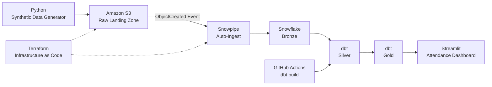
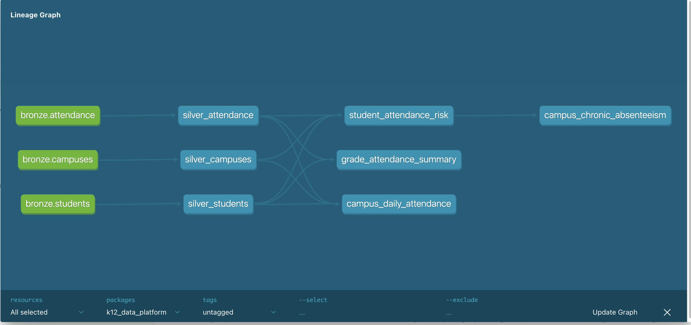
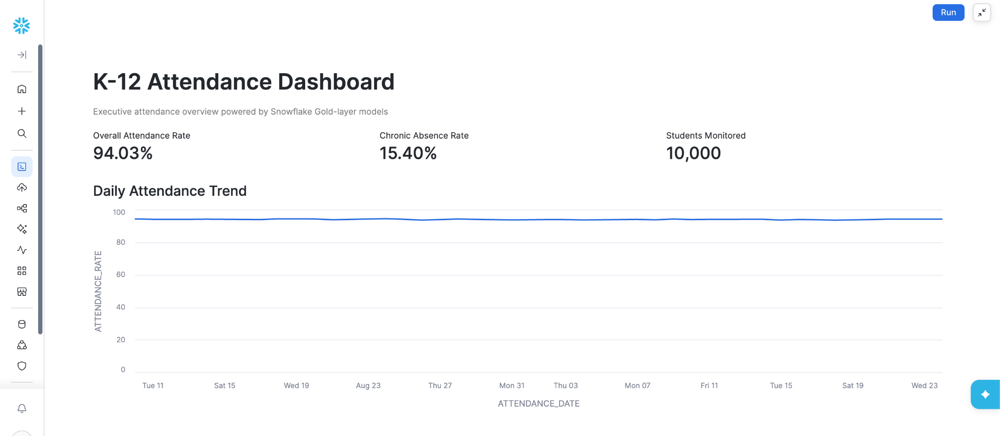
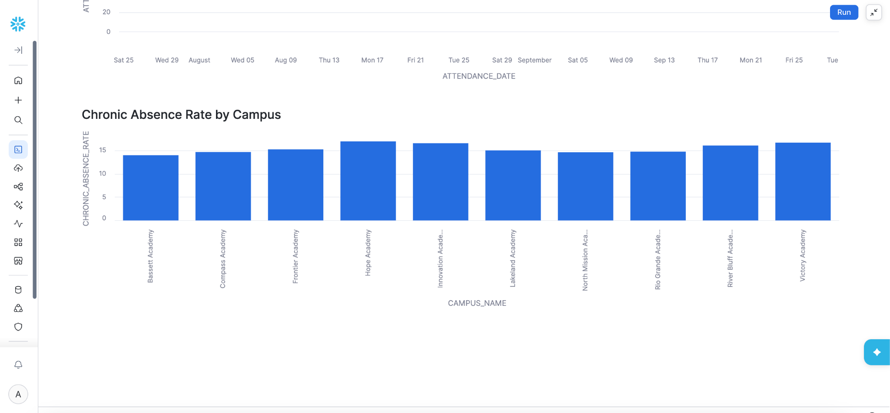

# K-12 Snowflake Data Platform


Production-style synthetic K-12 data platform built with ****Snowflake, AWS, SQL, Python, dbt, Terraform, GitHub Actions, and Streamlit****.


## Project Overview


This project demonstrates an end-to-end modern data engineering platform for a synthetic K-12 school environment.


The platform processes student attendance data through an automated pipeline from raw data ingestion to analytics-ready models and an executive dashboard.


The architecture follows a ****Bronze → Silver → Gold**** data modeling approach and includes:


- Event-driven incremental ingestion

- Data quality validation

- SQL transformation and dimensional modeling

- Pipeline orchestration

- Infrastructure as Code

- CI/CD

- Auditability and source-level traceability

- Failure detection and recovery

- Business-facing analytics


> ****Data Privacy:**** All student, campus, attendance, and assessment data used in this project is fully synthetic. No real student or confidential school data is used.


---


## Architecture





### End-to-End Data Flow


```text

Synthetic Data

      ↓

Python Generator

      ↓

Amazon S3

      ↓

S3 Event Notification

      ↓

Snowpipe

      ↓

Snowflake Bronze

      ↓

dbt Silver

      ↓

dbt Gold

      ↓

Streamlit Dashboard

```


The ingestion layer is ****event-driven****, while transformation and testing are orchestrated through ****GitHub Actions**** using `dbt build`.


---


## Technology Stack


| Technology | Purpose |

|---|---|

| Python | Synthetic data generation and pre-ingestion validation |

| Amazon S3 | Raw data landing zone |

| Snowpipe | Event-driven incremental ingestion |

| Snowflake | Cloud data warehouse |

| SQL | Data transformation, validation, and analytics |

| dbt | Transformations, testing, dependency management, and lineage |

| GitHub Actions | Pipeline orchestration and CI/CD |

| Terraform | Infrastructure as Code and configuration-drift detection |

| Streamlit in Snowflake | Executive attendance analytics dashboard |


---


## Data Pipeline


The platform uses a layered architecture to separate raw ingestion, trusted transformations, and business-facing analytics.


### Bronze Layer — Raw & Auditable


Attendance files are stored in Amazon S3 using date-based prefixes and incrementally ingested into Snowflake using Snowpipe.


```text

s3://k12-data-platform-gokhan/

└── raw/

    ├── campuses/

    ├── students/

    └── attendance/

        └── year=2026/

            ├── month=08/

            └── month=09/

```


Each Bronze attendance record preserves ingestion metadata including:


- `SOURCE_FILE` — identifies the S3 object that produced the record

- `LOADED_AT` — records when the data entered Snowflake


This provides source-level traceability for ****auditing, troubleshooting, and reprocessing****.


### Silver Layer — Clean & Trusted


dbt transforms Bronze data into trusted Silver models.


Transformations include:


- Standardizing attendance values

- Validating required identifiers

- Deduplicating attendance records

- Enforcing one attendance record per student per school day

- Validating relationships between students, campuses, and attendance records


Attendance deduplication uses a SQL window function:


```sql

QUALIFY ROW_NUMBER() OVER (

    PARTITION BY STUDENT_ID, ATTENDANCE_DATE

    ORDER BY LOADED_AT DESC

) = 1

```


This retains the latest version of a student's attendance record for each school day.


### Gold Layer — Business Analytics


Gold models provide analytics-ready datasets for reporting and dashboards.


Current models include:


- `CAMPUS_DAILY_ATTENDANCE`

- `GRADE_ATTENDANCE_SUMMARY`

- `STUDENT_ATTENDANCE_RISK`

- `CAMPUS_CHRONIC_ABSENTEEISM`


These models provide reusable business metrics without requiring analytics consumers to query or transform raw Bronze data.


---


## Data Quality


Data quality is enforced at multiple stages of the platform.


### Pre-Ingestion Validation


Python validation checks source data before ingestion for:


- Missing student IDs

- Duplicate student IDs

- Invalid attendance statuses

- Unknown student IDs

- Duplicate student/date attendance records


This prevents known bad data from entering the normal ingestion process.


### Warehouse Validation


dbt tests validate transformed data using:


- `not_null`

- `unique`

- `relationships`

- `accepted_values`


For example, attendance status is restricted to:


```text

PRESENT

ABSENT

TARDY

```


A failed critical data-quality test causes the dbt build to fail, providing a visible signal that the batch requires investigation.


---


## Incremental Ingestion


Attendance data is generated as daily files to simulate incremental production data arrival.


```text

New Attendance File

        ↓

Amazon S3

        ↓

S3 ObjectCreated Event

        ↓

Snowflake-managed SQS Notification

        ↓

Snowpipe

        ↓

Bronze Attendance

```


Snowpipe processes newly arriving files instead of reloading the complete historical attendance dataset.


This separates ****data ingestion**** from the scheduled ****transformation layer****.


---


## Orchestration & CI/CD


### dbt Pipeline


GitHub Actions orchestrates dbt execution.


The workflow can be triggered manually for testing and reruns or automatically on a schedule.


The pipeline:


1. Checks out the repository

2. Configures Python

3. Installs the Snowflake dbt adapter

4. Authenticates securely using GitHub Secrets

5. Executes `dbt build`

6. Runs models and tests according to the dbt dependency graph


Sensitive Snowflake credentials are injected at runtime through ****GitHub Secrets**** and are never hardcoded in source control.


### dbt Lineage

dbt manages model dependencies across the Bronze, Silver, and Gold layers.



The lineage graph shows how raw Bronze sources feed trusted Silver models and downstream analytics models. For example:

```text
bronze.attendance
        ↓
silver_attendance
        ↓
student_attendance_risk
        ↓
campus_chronic_absenteeism


### Terraform CI


Terraform infrastructure code is validated through a separate GitHub Actions workflow.


This provides automated checks for Infrastructure-as-Code changes before modifications are made to cloud infrastructure.


---


## Infrastructure as Code


Terraform manages the AWS S3 landing-zone configuration used by the data platform.


Managed configuration includes:


- S3 bucket

- Block Public Access

- Server-side encryption

- S3 event notification used by Snowpipe


Existing AWS resources were ****imported into Terraform state rather than recreated****.


This allowed the running infrastructure to be brought under Infrastructure-as-Code management without disrupting the existing pipeline.


`terraform plan` was then used to verify:


```text

No changes. Your infrastructure matches the configuration.

```


This also provides a mechanism for detecting future ****configuration drift**** between declared infrastructure and the actual AWS environment.


---


## Monitoring, Failure Handling & Troubleshooting


The project includes a tested failure-and-recovery scenario rather than demonstrating only successful pipeline executions.


An invalid attendance status (`SICK`) was intentionally introduced into a daily attendance batch.


### Failure Scenario


```text

Attendance CSV

      ↓

Amazon S3

      ↓

Snowpipe

      ↓

Bronze

      ↓

dbt Transformation

      ↓

accepted_values Test

      ↓

FAILED

      ↓

GitHub Actions ❌

```


The Bronze layer preserved the original source value and ingestion metadata, allowing the failure to be traced back to the exact source file.


dbt detected a value outside the accepted attendance statuses:


```text

PRESENT

ABSENT

TARDY

```


### Troubleshooting & Recovery


The failure was investigated using the following process:


1. Identified the failed GitHub Actions workflow.

2. Reviewed the `dbt build` results.

3. Located the failed `accepted_values` test.

4. Queried Snowflake to identify the invalid `SICK` record.

5. Used `SOURCE_FILE` metadata to identify the responsible batch.

6. Traced the record to:


```text

raw/attendance/year=2026/month=09/attendance_2026-09-24.csv

```


7. Corrected the problem at the source.

8. Reprocessed the corrected attendance batch.

9. Reran the dbt pipeline.

10. Verified that the data-quality tests and downstream models completed successfully.


```text

FAILED

   ↓

Detect

   ↓

Trace

   ↓

Root Cause

   ↓

Correct Source

   ↓

Reprocess

   ↓

Rerun

   ↓

SUCCESS

```


This demonstrates ****pipeline observability, source-level traceability, failure isolation, root-cause analysis, and controlled recovery****.


---


## Analytics Dashboard


A Streamlit application running in Snowflake consumes the analytics models and provides an executive view of attendance performance.


Current dashboard metrics include:


| KPI | Result |

|---|---:|

| Overall Attendance Rate | ****94.03%**** |

| Chronic Absence Rate | ****15.40%**** |

| Students Monitored | ****10,000**** |


The dashboard also includes:


- Daily Attendance Trend

- Chronic Absence Rate by Campus


The dashboard consumes business-ready models rather than performing transformation logic directly on raw data. This keeps business logic centralized in dbt and provides consistent metrics to downstream consumers.


### Dashboard Preview

#### Executive Attendance Overview



#### Chronic Absence by Campus



## Project Structure


```text

k12-snowflake-data-platform/

│

├── .github/

│   ├── dbt/

│   └── workflows/

│

├── data/

│   ├── generator/

│   ├── raw/

│   └── validation/

│

├── docs/

│   └── images/

│

├── k12_data_platform/

│   ├── models/

│   │   ├── silver/

│   │   └── gold/

│   └── dbt_project.yml

│

├── terraform/

│   ├── main.tf

│   ├── variables.tf

│   └── outputs.tf

│

└── README.md

```


---


## Key Engineering Concepts Demonstrated


- End-to-end ELT pipeline design

- Event-driven incremental ingestion

- Bronze, Silver, and Gold data modeling

- Pre-ingestion data validation

- Automated warehouse data-quality testing

- Referential integrity validation

- SQL window-function deduplication

- Auditability and source-level traceability

- dbt dependency management and lineage

- Scheduled pipeline orchestration

- Secure credential management with GitHub Secrets

- Infrastructure as Code

- Terraform configuration-drift detection

- CI validation

- Pipeline failure detection

- Root-cause analysis

- Controlled batch reprocessing

- Business-facing analytics


---


## Design Considerations


This project intentionally uses a synthetic local Python data generator to simulate an upstream operational source.


In a production environment, the source layer could instead consist of SIS, LMS, assessment platforms, APIs, vendor systems, or other operational databases.


The project currently uses elevated Snowflake privileges for development simplicity. A production implementation would use dedicated service roles and ****least-privilege RBAC**** for dbt, ingestion, and analytics workloads.


The transformation layer is scheduled rather than triggered for every individual source file. This allows multiple Bronze arrivals to be processed together in controlled transformation runs.


---


## Disclaimer


This project is an independent portfolio project inspired by common K-12 data engineering use cases.


It does ****not**** reproduce or claim access to any private production architecture, proprietary systems, confidential information, or student data belonging to IDEA Public Schools or any other school organization.


All data used in this project is synthetic.
